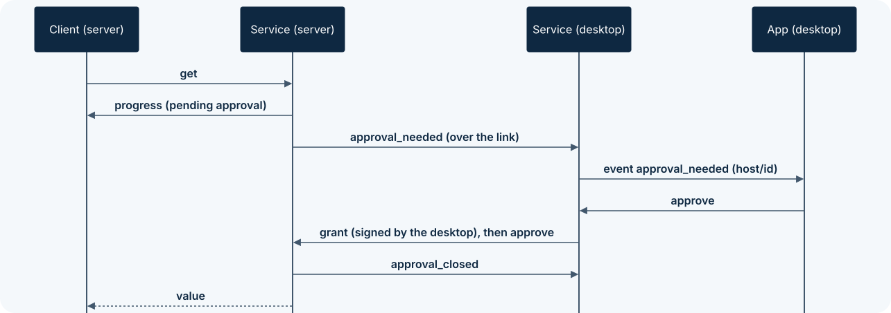
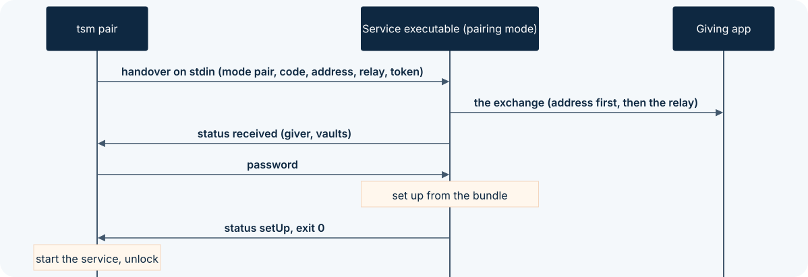

# tsm user guide

`tsm` is the Tom Secrets Manager on the command line. It reads secrets from
the local secrets service for scripts and programs, and starts, unlocks and
administers the service, on a desktop and on a headless machine. Its second
and third names, `git-credential-tsm` and `docker-credential-tsm`, are the
credential helpers of git and Docker.

The sessions shown here (the blocks starting with `$`) are real runs against
a demo installation, regenerated by the package's tests: they show what tsm
prints today. Messages and prompts go to standard error and appear before
the output; `[exit code N]` marks a command that failed.

## Contents

- [Before you start](#before-you-start)
- [Installing tsm](#installing-tsm)
- [Global options](#global-options)
- [References](#references)
- [Reading secrets](#reading-secrets)
- [The service on a headless host](#the-service-on-a-headless-host)
- [Approvals from the command line](#approvals-from-the-command-line)
- [Pairing a headless host](#pairing-a-headless-host)
- [Installing the service](#installing-the-service)
- [Keys, GitHub and the history](#keys-github-and-the-history)
- [Integrations and the helpers](#integrations-and-the-helpers)
- [Exit codes and troubleshooting](#exit-codes-and-troubleshooting)

## Before you start

- **Standard output carries values only.** Everything else (prompts,
  progress, messages) goes to standard error, so `$(tsm get ...)` captures
  the value and nothing else.
- **Admin commands need the `tsm` that comes with the service** (see
  [Installing tsm](#installing-tsm)); a `tsm` from pub.dev reads secrets
  but cannot administer.
- **The admin key.** At start, the service hands `tsm` an admin key, which
  `tsm` keeps in the OS keychain; later admin commands use it without
  asking. Where no keychain answers, for example in an SSH session on Linux,
  every admin command asks for the master password and claims the service,
  which issues a new admin key.
- **Who answers is checked first.** Before an admin command sends its key
  proof or a master password, and before it asks for the password, it
  checks that the admin endpoint is this user's service: the runtime
  directory and the socket are the user's alone, and the process answering
  runs as the user and is the service that belongs to this `tsm`. See
  [`service_untrusted`](#service_untrusted).
- **Which service it is, is checked too.** Every service has an identity
  key of its own. `tsm` pins it when it starts the service, and from then
  on sends its key proof or a master password only to the service that
  proves it holds that key; the master password is encrypted so that only
  that service reads it. See [`tsm trust`](#tsm-trust).
- **Every failure has its own exit code**, listed under
  [Exit codes and troubleshooting](#exit-codes-and-troubleshooting).

## Installing tsm

There are three ways to get `tsm`. Which one decides what it may do:

| Where from | Reads secrets | Administers the service |
| --- | --- | --- |
| The manager app's `tsm/bin` folder | yes | yes |
| The tools archive `tom_secrets_tsm-<version>-<platform>` | yes | yes |
| pub.dev (`dart pub global activate tom_secrets_tsm`) | yes | no |

The service accepts admin commands only from the `tsm` beside it; a `tsm`
from elsewhere is refused with `denied` (`wrong_executable`).

**To use the app's tsm on a desktop:**

1. Install the manager app (its user guide says how). `tsm` and the service
   are in its `tsm/bin` folder; on macOS
   `Tom Secrets Manager.app/Contents/Resources/tsm/bin`.
2. Link `tsm` onto your `PATH`, for example on macOS:

   ```sh
   ln -s "/Applications/Tom Secrets Manager.app/Contents/Resources/tsm/bin/tsm" /usr/local/bin/tsm
   ```

   On Windows, add the app's `tsm\bin` folder to the user's `Path`
   (Settings › System › About › Advanced system settings › Environment
   Variables).

**To install tsm on a server without a desktop:**

1. Download `tom_secrets_tsm-<version>-<platform>` from the release and
   check it against the release's `SHA256SUMS`.
2. Unpack it into a folder of its own, for example `/opt/tsm`: `tsm` and
   `tom_secrets_service` stay side by side in `bin/`, with `lib/` beside.
3. Put the folder on `PATH`, for example in `~/.profile`:

   ```sh
   export PATH="/opt/tsm/bin:$PATH"
   ```

4. Set the machine up with [`tsm pair`](#tsm-pair), or start a service
   that has a `bootstrap.yaml` with [`tsm start`](#tsm-start).

**To install tsm from pub.dev** (reading only, for a machine whose service
was installed another way):

```sh
dart pub global activate tom_secrets_tsm
```

Dart puts `tsm` into `~/.pub-cache/bin`, which must be on `PATH`.

## Global options

Global options go before the command (`tsm --password-stdin unlock`); `-v`
and `-h` also after it.

| Option | Meaning |
| --- | --- |
| `--password-stdin` | Read the master password from the first line of standard input instead of the terminal. For automation; the password then passes through whatever feeds standard input (a file, a pipe, the shell history), so keep that as safe as the password. With `pair` there is no second try. |
| `-v`, `--verbose` | Verbose output. |
| `-h`, `--help` | The help: `tsm --help` lists the commands, `tsm <command> --help` the command's options. |
| `--version` | Print tsm's version. |
| `--dump-definitions` | Print every command and option as YAML (the tool's definition). |
| `--completion=<shell>` | Print a shell completion script for `bash`, `zsh` or `fish`, e.g. `tsm --completion=zsh > ~/.zfunc/_tsm`. |

## References

A reference names a secret: an entry, one of its fields and, optionally,
values for dimensions. The three forms of an entry:

| Form | Example | Names |
| --- | --- | --- |
| key | `telegram.bot_token` | the entry whose `tsm.key` field is that key, in any store the service serves |
| path | `fleet/Cloud/AWS/root` | store `fleet`, group path `Cloud/AWS`, entry title `root` |
| uuid | `fleet/~0123456789abcdef0123456789abcdef` | the entry with that UUID in store `fleet`; survives renames and moves |

Around it:

- `#field` picks the field: `Title`, `UserName`, `Password`, `URL`, `Notes`,
  a custom field, `attachment%3A<name>` for an attachment, or `totp` for the
  current one-time code. Without it the field is `Password`.
- `[dimension:value,...]` in front sets dimensions for this request:
  `[env:prod]db.main`, `[env:prod,host:server1]db.main`. The dimensions a
  vault uses (`host`, `platform`, `env`, ...) are those of its configuration;
  a value not given takes this machine's (its host name, its platform) or
  the dimension's default.
- The reserved characters `/ # [ ] , : %` inside a name are written as `%`
  and two hex digits: a title `a/b` is `a%2Fb`. Quote references in the
  shell: `[` and `#` mean something to it.

Examples:

| Reference | Names |
| --- | --- |
| `team/Api/Token` | the Password of entry `Token` in group `Api` of store `team` |
| `'team/Code/Example git#UserName'` | its user name (quoted: a space and `#`) |
| `'[env:prod]db.main'` | the entry with key `db.main`, as resolved for `env=prod` |
| `'fleet/Certs/Server#attachment%3Akey.pem'` | the attachment `key.pem` |
| `'team/Code/Example git#totp'` | the current one-time code |

### `tsm ref`

Checks and builds references without asking the service.

```text
tsm ref parse <reference>
tsm ref format (--key K | --store S --path SEG… | --store S --uuid HEX)
               [--field F] [--qualifier name:value]…
```

| Option | Meaning |
| --- | --- |
| `--key` | The entry's key (the key form). |
| `--store` | The store (the path and uuid forms). |
| `--path` | A path segment: the groups, then the entry's title; repeated. |
| `--uuid` | The entry's UUID, 32 hex digits. |
| `--field` | The field. |
| `--qualifier` | A dimension value, `name:value`; repeated. |

`ref parse` prints the parts as JSON; `ref format` prints the **canonical
form**, the form grants, the audit log and approval prompts use.

<!-- transcript ref -->
```text
$ tsm ref parse '[env:prod]team/Code/Example git#UserName'
{
  "canonical": "[env:prod]team/Code/Example git#UserName",
  "target": {
    "kind": "path",
    "store": "team",
    "segments": [
      "Code",
      "Example git"
    ]
  },
  "field": "UserName",
  "fieldGiven": true,
  "qualifiers": [
    {
      "dimension": "env",
      "value": "prod"
    }
  ]
}
$ tsm ref format --store team --path Code --path 'Example git' --field UserName --qualifier env:prod
[env:prod]team/Code/Example git#UserName
$ tsm ref parse '[env:prod'
tsm: malformed: the reference is malformed: unclosed_qualifiers (reason unclosed_qualifiers)
[exit code 8]
```

Errors: a reference that does not parse is `malformed` (exit 8), with the
reason. The full grammar, the escaping rules and every reason a reference
is refused are in
[the protocol, section 4](../../../../protocol/protocol.md#4-references).

## Reading secrets

### `tsm get`

Prints one value: the reference's field, without a trailing line break.

```text
tsm get <reference> [--field F] [--dim name=value]… [--no-wait]
        [--timeout S] [--base64] [-n]
```

| Option | Meaning |
| --- | --- |
| `--field` | The field (instead of `#field` in the reference). |
| `--dim` | A dimension value, `name=value`, for this request; repeated. |
| `--no-wait` | Answer at once instead of waiting for an unlock or an approval (exit 4 when locked). |
| `--timeout` | Wait at most this many seconds. |
| `--base64` | Print the value as base64; needed for a binary value (an attachment, a key file). |
| `-n`, `--newline` | End the value with a line break. |

<!-- transcript get-values -->
```text
$ tsm get team/Api/Token -n
demo-api-token
$ tsm get 'team/Code/Example git' --field UserName -n
demo-git-user
$ tsm get 'team/Code/Example git' --field URL -n
https://git.example.com
$ tsm get demo.logo --field Title -n
Logo
```

In a shell script:

```sh
#!/bin/sh
set -e
DB_PASSWORD="$(tsm get fleet/Db/Main)"
export DB_PASSWORD
exec ./migrate
```

`get` waits for an unlock or an approval, and says so on standard error.

Errors:

<!-- transcript get-errors -->
```text
$ tsm get team/Api/Missing
tsm: not_found: no entry for team/Api/Missing with host=demo-host, platform=linux, env=default
[exit code 6]
$ tsm get demo.logo
tsm: not_found: team/Logo has no field Password
[exit code 6]
$ tsm get '[env:prod'
tsm: malformed: the reference is malformed: unclosed_qualifiers (reason unclosed_qualifiers)
[exit code 8]
```

- `not_found` (exit 6): no entry matches, or it lacks the field.
- `malformed` (exit 8): the reference does not parse.
- A binary value without `--base64` is refused with exit 2.
- `locked` (exit 4) with `--no-wait`; `timeout` (exit 9) after
  `--timeout`; `denied` (exit 5) when the approver refused.

### `tsm run`

Runs a command with secrets in its environment: every reference fetched in
one request (so the approver sees one prompt for all of them), the command
started only when all were answered, its exit code tsm's.

```text
tsm run [--map VAR=ref]… [--env-file FILE]… [--file VAR=ref]…
        [--dim name=value]… -- <command> [args…]
```

| Option | Meaning |
| --- | --- |
| `--map` | An environment variable and its reference, `VAR=ref`; repeated. |
| `--env-file` | A file of `VAR=ref` lines. It holds no secrets, so it can be committed beside the project. |
| `--file` | A value as a temporary file, its path in `VAR`, deleted when the command ends; a certificate or PGP key entry gives its private key. |
| `--dim` | A dimension value for every reference, `name=value`; repeated. |

<!-- transcript run-map -->
```text
$ tsm run --map API_TOKEN=team/Api/Token --map 'GIT_USER=team/Code/Example git#UserName' -- printenv API_TOKEN GIT_USER
demo-api-token
demo-git-user
```

The values exist only in the command's environment; nothing is written to
disk. `tsm` passes standard input and output through, forwards Ctrl-C and
SIGTERM, and exits with the command's exit code. If any reference fails,
the command is not started.

**Key material as a file.** A program that wants a key as a file gets it
with `--file`:

<!-- transcript run-file -->
```text
$ tsm run --file TOKEN_FILE=team/Api/Token -- sh -c 'cat "$TOKEN_FILE"'
demo-api-token
```

```sh
tsm run --file TLS_KEY=fleet/Certs/Web \
        --file TLS_CERT='fleet/Certs/Web#attachment%3Acertificate.pem' \
        -- ./server --key "$TLS_KEY"
```

- Without a field, a certificate entry gives its private key
  (`private-key.pem`, or its PKCS#12 bundle `certificate.p12`), a PGP key
  entry its secret key (`private-key.asc`), any other entry its Password.
  A `#field` names another field or attachment.
- The file is in a directory of its own (mode 700) and has mode 600; it is
  named after the field. `tsm` overwrites it with zeros and deletes it when
  the command ends, also when it fails or is interrupted with Ctrl-C.

**An environment file** maps variables to references, one `VAR=reference`
per line; empty lines and lines starting with `#` are skipped:

```text
# deploy.tsm.env: variables and the references they are read from
DB_USER=fleet/Db/Main#UserName
DB_PASSWORD=fleet/Db/Main
BOT_TOKEN=[env:prod]telegram.bot_token
```

```sh
tsm run --env-file deploy.tsm.env --map EXTRA=fleet/Misc/Extra -- ./deploy.sh
```

Errors: those of [`tsm get`](#tsm-get) for each reference, before the
command starts; a binary value mapped to a variable is `malformed`
(exit 8); `--file` from a service that does not offer it is `unsupported`
(exit 10). Once the command started, the exit code is the command's.

## The service on a headless host

On a desktop the manager app starts and unlocks the service. On a server,
`tsm` does it.

### `tsm start`

Starts the service; its admin key is kept in the keychain.

```text
tsm start [--unlock] [--bootstrap FILE] [--service EXE] [--key-file F]
```

| Option | Meaning |
| --- | --- |
| `--unlock` | Unlock it too (asks for the master password). |
| `--bootstrap` | The bootstrap file (default: `bootstrap.yaml` in the data directory, `TSM_DATA_DIR`). |
| `--service` | The service executable (default: `TSM_SERVICE`, else `tom_secrets_service` beside `tsm`). |
| `--key-file` | The key file the primary vault is opened with, when this machine's keychain does not hold it. |

```sh
tsm start            # prints started (or already running)
tsm start --unlock   # started, then the master password, then unlocked
```

After `started`, `tsm` prints the service's identity as eight words
(`identity harbor-violet-…`) and pins it: the service says its identity
key to the `tsm` that started it, and every later admin command checks
that the service answering holds that key (see [`tsm trust`](#tsm-trust)).

**Unattended start.** A start script that cannot type the password uses
`--password-stdin`, which reads the first line of standard input:

```sh
tsm --password-stdin start --unlock < /run/credentials/tsm-master
```

The password is then exactly as safe as the file or pipe it comes from.

Errors: `tsm: no bootstrap file at …` (exit 6: the machine is not set up;
see [`tsm pair`](#tsm-pair)); `tsm: no service executable at …` (the
service is not beside `tsm`; give `--service`).

### `tsm unlock` and `tsm lock`

`unlock` opens the vaults with the master password; `lock` drops every
secret from memory. The service keeps running while locked, and requests
wait for the next unlock.

```text
tsm unlock [--key-file F]
tsm lock
```

| Option | Meaning |
| --- | --- |
| `--key-file` | (`unlock`) The key file the primary vault is opened with. |

<!-- transcript lock-unlock -->
```text
$ tsm lock
locked
$ tsm get team/Api/Token --no-wait
tsm: locked: the service is locked
[exit code 4]
$ tsm unlock
Master password:
unlocked
identity harbor-violet-cedar-lantern-maple-orbit-pebble-quill
$ tsm get team/Api/Token -n
demo-api-token
```

After `unlocked`, `unlock` prints the service's identity words. They are
the words the manager app on your other devices shows for this machine in
its device list: when you look at them there, they are the same.

Errors: `denied` (`bad_password`, exit 5) after a wrong password;
`not_running` (exit 3); `service_untrusted` (`unpinned`, exit 12) and
`service_key_changed` (exit 13), see [`tsm trust`](#tsm-trust).

### `tsm status`

The service, its stores with their state and the age of their copy, and the
keys due a reminder.

```text
tsm status [--json]
```

| Option | Meaning |
| --- | --- |
| `--json` | Print JSON instead of lines. |

<!-- transcript status -->
```text
$ tsm status
service  running, unlocked, lock mode b, version 0.26.2
identity harbor-violet-cedar-lantern-maple-orbit-pebble-quill
agent    /run/user/1000/tsm/agent.sock  (SSH_AUTH_SOCK or IdentityAgent for ssh)
store    primary  current  file  fetched just now
store    team  current  file  fetched just now
```

- `identity` is the service's identity as words (see
  [`tsm trust`](#tsm-trust)); `tsm status --json` has its fingerprint too.
- `agent` is the service's ssh-agent: `tsm integrations install ssh` points
  `ssh` at it (see [`tsm integrations`](#tsm-integrations)), or by hand
  `export SSH_AUTH_SOCK=<that path>`.
- Each store shows its state (`current`, `offline`, `token_expired`, ...),
  where its copy comes from (`github`, `file`, `cache`) and how old the copy
  is. A store on the copy held (GitHub cannot serve it now) says why
  (`GitHub not reachable`, or `token expired: enter a new one`); a copy
  older than 7 days is flagged `offline copy older than 7 days`.
- Lines starting with `expiring` name the keys a reminder is due for, with
  their expiry date (as [`tsm keys`](#tsm-keys) shows them).

Errors: with no service running, `status` prints `not running` and exits 3,
so a script can check it.

### `tsm reload`

Fetches every store now instead of waiting for the next refresh.

```text
tsm reload
```

<!-- transcript reload -->
```text
$ tsm reload
reloaded
```

Errors: `offline` or `token_expired` (exit 11): a store could not be
fetched; it keeps serving the copy it holds, and `tsm status` shows why.

### `tsm trust`

Shows the identity of the service on this machine, and pins it.

```text
tsm trust [<words | fingerprint | key file>]
tsm trust --list
tsm trust --remove [--host NAME]
```

| Option | Meaning |
| --- | --- |
| `--list` | List the services pinned. |
| `--remove` | Remove the pin of this machine's service (with `--host`: every pin of that host). |
| `--host` | The host whose pins `--remove` removes. |

Every service has an identity key, made at its first start and kept in its
data directory (`service-identity.json`); it stays the same across restarts
and updates. Its fingerprint is shown as eight words. `tsm` and the manager
app keep the keys of the services they know in one file, the *pins*
(`~/.config/tsm/services`; on Windows `%APPDATA%\tsm\services`), and send
an admin key's proof or a master password only to a service that proves it
holds the pinned key. The master password of a claim is encrypted to a
one-time key that service signed, so nothing else on the machine reads it.

A service is pinned without your doing:

- when `tsm start` or the manager app starts it (it says its key to the
  program that started it);
- when the machine is set up with [`tsm pair`](#tsm-pair);
- when you unlock: the keys of your other devices' services, which the
  primary vault records, are pinned for those hosts.

You pin by hand only when `tsm` meets a running service it did not start
and has no pin for (`service_untrusted`, reason `unpinned`): the error
shows the words the service presents. Compare them with the words another
of your devices shows for this machine (the manager app's Pairing screen,
the device list) or with what `tsm status` showed here before, and give
them:

<!-- transcript trust -->
```text
$ tsm trust
identity harbor-violet-cedar-lantern-maple-orbit-pebble-quill
fingerprint 5c1e5c1e5c1e5c1e5c1e5c1e5c1e5c1e5c1e5c1e5c1e5c1e5c1e5c1e5c1e5c1e
pinned
$ tsm trust harbor-violet-cedar-lantern-maple-orbit-pebble-quill
trusted harbor-violet-cedar-lantern-maple-orbit-pebble-quill
$ tsm trust harbor violet cedar lantern maple orbit pebble wrong
tsm: the service on this machine presents another identity: harbor-violet-cedar-lantern-maple-orbit-pebble-quill; nothing was pinned
[exit code 13]
```

- Without an argument, `trust` shows what the service presents and whether
  it is pinned; it pins nothing.
- The words may be given with hyphens or spaces; the fingerprint is the 64
  hexadecimal digits; a file holds the public key in base64.
- `--list` prints each pin: the host, the runtime directory (or `(wherever
  it answers)` for a pin from a device record), the words, where the pin
  came from (`start`, `pairing`, `trust`, `rotation`) and when.

**When the key changed** (`service_key_changed`, exit 13): the service
presents another key than the pinned one. `tsm` sends nothing and offers no
way to go on. If you set the service up anew or replaced its data
directory, remove the old pin (`tsm trust --remove`) and start the service
with `tsm start`, or compare the new words and give them to `tsm trust`.
If you did neither, something else answers in the service's place: do not
enter the master password. A key the manager app rotated (Keys, "This
service's identity key") needs nothing: the old key signs the new one, and
`tsm` follows.

Errors: `service_key_changed` (exit 13) when the words given are not the
ones the service presents; `not_found` (exit 6) when `--remove` finds no
pin; `not_running` (exit 3).

### `tsm stop`

Locks and stops the service.

```text
tsm stop
```

<!-- transcript stop -->
```text
$ tsm stop
stopped
$ tsm status
not running
[exit code 3]
```

Errors: `not_running` (exit 3).

## Approvals from the command line

The first time a program reads a secret, the service asks an approver. On a
desktop that is the manager app. A headless host paired with your desktop
asks the desktop's app over the **approval link** while the desktop's
service is unlocked:



<!-- diagram 1-headless-approval
```mermaid
sequenceDiagram
  participant C as Client (server)
  participant H as Service (server)
  participant D as Service (desktop)
  participant A as App (desktop)
  C-&gt;&gt;H: get
  H-&gt;&gt;C: progress (pending approval)
  H-&gt;&gt;D: approval_needed (over the link)
  D-&gt;&gt;A: event approval_needed (host/id)
  A-&gt;&gt;D: approve
  D-&gt;&gt;H: grant (signed by the desktop), then approve
  H-&gt;&gt;D: approval_closed
  H--&gt;&gt;C: value
```
-->

The flows describe it in full:
[a server's prompt on the user's desktop](https://github.com/al-the-bear/tom_secrets_manager/blob/main/doc/flows.md#a-servers-prompt-on-the-users-desktop).
When no approver is connected, the request waits with an **approval
code**, ten characters such as `K7QX2MBR4D`:

```text
tsm: waiting for approval: approve code K7QX2MBR4D on a trusted device, then run `tsm approve <token>` here
```

**To answer an approval code:**

1. On the waiting host, see what waits: [`tsm approvals`](#tsm-approvals).
2. On a trusted device (one paired as an approver), turn the code into a
   **token**: in the manager app (Clients › Approval code), or where the
   app has switched command-line approvals on, with
   [`tsm approve-code`](#tsm-approve-code).
3. On the waiting host, give the token to [`tsm approve`](#tsm-approve).
   The waiting `get` or `run` then goes on.

Or have the app on the trusted device record the approval in the primary
vault, and run `tsm approve` without a token on the waiting host.

### `tsm approvals`

The requests waiting on this host, with their approval codes.

```text
tsm approvals [--json]
```

| Option | Meaning |
| --- | --- |
| `--json` | Print JSON instead of lines. |

<!-- transcript approvals -->
```text
$ tsm approvals
no request waits
```

With a request waiting it prints its code, the reference and the program:

```text
K7QX2MBR4D  fleet/Db/Main  /opt/app/bin/server
```

### `tsm approve`

Redeems a one-time approval token; without a token, has the service take
the approvals recorded in the primary vault.

```text
tsm approve <token>
tsm approve -
tsm approve
```

The token's spaces, dashes and lower case are accepted; `-` reads it from
standard input (`echo MFRG… | tsm approve -`). The token is single-use and
expires with its code.

<!-- transcript approve -->
```text
$ tsm approve MFRG-GZDF-MZTW-Q2LK-NNWG-23TP-OB
tsm: denied: the token answers nothing (reason bad_token)
[exit code 5]
$ tsm approve
reloaded: approvals recorded in the primary are taken
```

Errors: `denied` with `bad_token` (exit 5): the token answers no waiting
request (mistyped, used, or its code expired).

### `tsm approve-code`

On a trusted device with command-line approvals switched on (manager app,
Settings): prints the token for an approval code shown on another host.

```text
tsm approve-code <code> --host H [--decision D] [--secret S]
```

| Option | Meaning |
| --- | --- |
| `--host` | The host the code was shown on. |
| `--decision` | `once` (the default: this request only), `always` or `never`. |
| `--secret` | What a lasting decision covers: `ref` (the default: this reference), `store` or `all`. |

On a device that approves for `server1`, it prints the token to type there,
for example `MFRGGZDFMZTWQ2LKNNWG23TPOB`. On a device that does not:

<!-- transcript approve-code -->
```text
$ tsm approve-code K7QX2MBR4D --host server1
tsm: not_found: no paired host server1
[exit code 6]
```

Errors: `not_found` (exit 6) for a host this device has not paired;
`denied` (`not_allowed_op`, exit 5) while command-line approvals are off;
a `--decision` or `--secret` other than those above is a usage error
(exit 2).

### `tsm allow`

Pre-approves: makes a grant in advance, so the program is not asked about.
Only where command-line approvals are switched on.

```text
tsm allow <host> <subject> <reference|store NAME|all> [--never]
          [--pin hash|off]
```

| Option | Meaning |
| --- | --- |
| `--never` | A never grant: refused without asking. |
| `--pin` | `hash` binds the grant to the program file as it is now; `off` does not. |

- The host is the machine the grant holds on; the subject is the program,
  as `exe <path>`, `script <interpreter> <path>`, `interpreter <path>` or
  `folder <path> [interpreter]`.
- The secret is a reference in canonical form ([`tsm ref`](#tsm-ref)
  prints it), `store <name>` or `all`.

<!-- transcript allow-grants -->
```text
$ tsm allow server1 'exe /opt/app/bin/server' team/Api/Token
granted
$ tsm grants
g-3f9c2a71e0b84d65  server1  allow  exe /opt/app/bin/server  team/Api/Token
```

Errors: `denied` (`not_allowed_op`, exit 5) while command-line approvals
are off; `malformed` (exit 8) for a subject or reference that does not
parse.

### `tsm grants`

Shows the grants, or revokes one.

```text
tsm grants [list] [--host H] [--json]
tsm grants revoke <host> <grantId>
```

| Option | Meaning |
| --- | --- |
| `--host` | Only this host's grants. |
| `--json` | Print JSON instead of lines. |

Each line is the grant's id, host, decision, subject and what it covers,
and when it was last used (see the transcript of [`tsm allow`](#tsm-allow);
with none, `no grant`). To revoke one, give its host and id; `tsm` prints
`revoked`:

```sh
tsm grants revoke server1 g-3f9c2a71e0b84d65
```

Errors: `locked` (exit 4) while the service is locked: grants live in the
primary vault.

### `tsm audit`

The audit log: who asked for which secret and what they got (allowed,
denied and why, timed out), never a value. One line per request: the time,
the outcome, the reference and the program.

```text
tsm audit [--since T] [--until T] [--subject S] [--ref R] [--json]
```

| Option | Meaning |
| --- | --- |
| `--since` | From (ISO 8601); default 7 days ago. |
| `--until` | To (ISO 8601); default now. |
| `--subject` | Only this program (as in a grant: `exe <path>` ...). |
| `--ref` | Only this reference. |
| `--json` | Print JSON instead of lines. |

```sh
tsm audit --since 2026-11-01 --ref fleet/Db/Main
tsm audit --subject 'exe /opt/app/bin/server' --json
```

It prints nothing when no request falls in the period. The approval flow
is described in
[the protocol, section 7](../../../../protocol/protocol.md#7-approvals-and-grants).

## Pairing a headless host

A machine that has no vaults yet is set up by **pairing** with a machine
that has them, typically your desktop. The desktop gives the new machine
the vaults you choose, the shared configuration and the GitHub tokens
pasted for it; the new machine records the desktop as its approver.



<!-- diagram 2-pair-headless
```mermaid
sequenceDiagram
  participant T as tsm pair
  participant S as Service executable (pairing mode)
  participant G as Giving app
  T-&gt;&gt;S: handover on stdin (mode pair, code, address, relay, token)
  S-&gt;&gt;G: the exchange (address first, then the relay)
  S-&gt;&gt;T: status received (giver, vaults)
  T-&gt;&gt;S: password
  Note over S: set up from the bundle
  S-&gt;&gt;T: status setUp, exit 0
  Note over T: start the service, unlock
```
-->

The flows describe it and every other route:
[`tsm pair` on a server](https://github.com/al-the-bear/tom_secrets_manager/blob/main/doc/flows.md#tsm-pair-on-a-server).

### `tsm pair`

Sets this machine up by pairing; then the master password, and the service
is started and unlocked.

```text
tsm pair <host:port> <code> [--device NAME] [--link ADDRESS:PORT]
         [--device-key MODE] [--service EXE]
tsm pair [<host:port>] <code> --relay RELAY [--token-env VAR]
         [--relay-api URL] [...]
```

| Option | Meaning |
| --- | --- |
| `--device` | This machine's name, as the other machines and the grants know it. Default: the host name. |
| `--device-key` | Where the device settings' key is kept: `auto` (the keychain where one is available, else the primary vault; the default), `keychain`, `vault` or `keyfile` (a key file beside the settings). |
| `--link` | Where this machine's approval link listens: a VPN or LAN address of this machine and a port (`10.0.0.9:47731`), never every interface. The desktop is told it, opens the link and answers this machine's prompts at once. Without it the machine has no link and its prompts wait for approval codes. |
| `--relay` | The relay the pairing goes through when the desktop is neither on this network nor the VPN: a relay server `tsm:<url>`, a GitHub repository `github:<owner>/<repo>`, or a magic-wormhole server `wormhole:<url>`. Tried after the address, or alone. |
| `--token-env` | The environment variable holding the relay's token (never the token itself): with a GitHub relay this machine's own GitHub token for the repository (needed), with a relay server the relay's instance token for the approval link through it (optional), with a wormhole server refused. |
| `--relay-api` | With a GitHub relay: the GitHub API's URL, for GitHub Enterprise Server (default `https://api.github.com`). |
| `--service` | The service executable (default: `TSM_SERVICE`, else `tom_secrets_service` beside `tsm`). |

**To pair on the LAN or over the VPN:**

1. On the desktop, open the manager app's Pairing screen and choose "Pair
   a device". It shows an **address** (`host:port`) and a one-time
   **code** (`<number>-<word>-<word>`) for at most five minutes.
2. On the new machine:

   ```sh
   tsm pair 10.0.0.5:47900 7-guitar-orbit --device server1
   ```

3. On the desktop, tick the vaults the new machine gets and choose
   "Pair *name*". `tsm` prints what it got:

   ```text
   paired with desktop1; it gave:
     fleet (primary)  github:example-org/fleet-vault
     the shared configuration
     a GitHub token for example-org/fleet-vault
   ```

4. Type the master password (three tries). The service writes the setup
   into the data directory, and `tsm` starts and unlocks it:

   ```text
   set up (/home/ops/.local/share/tom-secrets-manager/bootstrap.yaml)
   started
   unlocked
   ```

The address is always typed: `tsm` does not search the network, so pairing
works over a VPN, which mDNS does not cross.

**To switch the approval link on** (so the desktop answers this machine's
prompts), add `--link` with an address of this machine the desktop
reaches: `tsm pair 10.0.0.5:47900 7-guitar-orbit --link 10.0.0.9:47731`.
`tsm` then also prints `approval link on 10.0.0.9:47731` after `set up`.

**To pair through a relay**, when the new machine reaches neither the
desktop's network nor the VPN: on the desktop, choose the relay under "Also
through a relay" before "Pair a device"; the Pairing screen names it beside
the code. On the new machine, give the code and the relay:

- **A relay server** (`tom_secrets_relay`), no token needed for the
  pairing:

  ```sh
  tsm pair 42-guitar-orbit --relay tsm:https://relay.example --device server1
  ```

  The relay server also carries the **approval link** when the two
  machines do not reach each other later. A relay in token mode needs its
  instance token for that: `read -rs TSM_RELAY_TOKEN && export
  TSM_RELAY_TOKEN`, then `--token-env TSM_RELAY_TOKEN`; the service keeps
  it in the keychain.

- **A GitHub repository** (one of your vault repositories), with this
  machine's own fine-grained token for it (contents read and write):

  ```sh
  read -rs TSM_PAIR_TOKEN && export TSM_PAIR_TOKEN
  tsm pair 42-guitar-orbit --relay github:example-org/fleet-vault \
    --token-env TSM_PAIR_TOKEN --device server1
  ```

  The token is never an argument, so it shows in no process list or shell
  history; `tsm` hands it to the service on its standard input, and the
  machine keeps it for that repository. The pairing's messages are files
  under `relay/pair/<number>/` in the repository, polled every two seconds
  and deleted when both sides are done.

- **A magic-wormhole server**, the public one or your team's, no token:

  ```sh
  tsm pair 42-guitar-orbit --relay wormhole:ws://relay.magic-wormhole.io:4000/v1
  ```

  It carries pairing only (no approval link, no mailbox); the public
  server is run by volunteers and is not always up.

With an address too, the address is tried first and the relay only when
nothing answers there.

Errors:

<!-- transcript pair-set-up -->
```text
$ tsm pair 10.0.0.5:47900 7-guitar-orbit
tsm: this machine is set up already (/home/demo/.local/share/tom-secrets-manager/bootstrap.yaml)
[exit code 5]
```

- `denied` (exit 5): the machine is set up already (a `bootstrap.yaml` in
  its data directory, as above), the desktop declined, or a relay failed
  (the message names the relay and what it said, for example `no pairing
  is open under 42`).
- A wrong code closes the desktop's window: open a new one there.
- `denied` (`wrong_password`) after three wrong master passwords; with
  `--password-stdin` there is no second try.

## Installing the service

The service comes with `tsm` and the manager app and runs from their
folder. Installed, it runs from a place of its own, in one of two forms:

- **For you, on its own** (macOS, Linux, Windows): the tools copied into a
  folder of yours, the service started there at every login. It keeps
  running when the app quits, is ended or is updated. On Windows this
  matters most: the app's package ends the processes it started, so a
  service the app started ends with the app.
- **For every user of a shared Linux server** (the system install, as
  root): the service root's and set-group-ID to the group `tsm-identity`,
  and each user's identity key (see [`tsm trust`](#tsm-trust)) kept in a
  directory only that group reaches. Started by a user, the service runs as
  that user; it reads that user's key with the group's rights and drops
  the group at once. The kernel then keeps the user's other processes out
  of its memory, and the loader ignores `LD_PRELOAD` and similar
  variables, so no other program of the user can read the key or pose as
  the service. Without it the key is a file in the user's data directory,
  which the user's other programs can read.

The system-installed service uses the user's default directories: the data
directory `~/.local/share/tom-secrets-manager` and the runtime directory
`/run/user/<uid>/tsm` (else `/tmp/tsm-<uid>`). `TSM_DATA_DIR`,
`TSM_RUNTIME_DIR`, `XDG_DATA_HOME` and the bootstrap's `runtime_dir` do
not move it.

### `tsm install`

Installs the service: for you, or with `--system` for every user of this
Linux machine (as root).

```text
tsm install [--app EXE] [--no-login] [--service EXE] [--plan]
tsm install --system [--service EXE] [--plan]
```

| Option | Meaning |
| --- | --- |
| `--system` | For every user of this Linux machine, as root. |
| `--app` | A manager app the installed service admits as an admin (its executable); the app names itself when it installs. |
| `--no-login` | Do not start it at login. |
| `--service` | The service executable to install (default: `TSM_SERVICE`, else `tom_secrets_service` beside `tsm`). |
| `--plan` | List the steps; change nothing. |

**For you.** From the app's tools folder or the unpacked
`tom_secrets_tsm-<version>-<platform>` archive:

```sh
./bin/tsm install
```

It copies `bin/` and `lib/` into your install folder, records the install
in its `install.json` and starts the service from there at login:

| Platform | Folder | Started at login by |
| --- | --- | --- |
| macOS | `~/Library/Application Support/TomSecretsManagerService` | a LaunchAgent, `com.althebear.tomsecrets.service` |
| Linux | `~/.local/lib/tom-secrets-manager` | a systemd user unit, `tom-secrets-manager.service` |
| Windows | `%LOCALAPPDATA%\Programs\TomSecretsManager` | the value `TomSecretsManagerService` of your Run key |

On Linux it also links `~/.local/bin/tsm` to the installed `tsm` (unless
another file is there). `TSM_INSTALL_DIR` names another folder. The app's
Settings › This machine › "Run the service on its own" does the same.

From then on `tsm start` and the app start the installed service, and
both expect it. The service running at the install goes on until it is
stopped; the installed one starts at the next login or `tsm start`.

- **An update of the app** does nothing to the installed service: it keeps
  running, and the updated app attaches to it. To bring it up to date,
  run `tsm install` from the new release (or the app's "Update from this
  app"), then `tsm stop` and `tsm start`.
- **To stop it:** `tsm stop`; it starts again at the next login.

**For every user (`--system`).** From the unpacked
`tom_secrets_tsm-<version>-linux-<arch>` archive:

```sh
sudo ./bin/tsm install --system
```

It makes the group `tsm-identity` when missing, copies `bin/` and `lib/`
to `/opt/tom-secrets-manager` (root's), makes the service set-group-ID to
the group, makes `/var/lib/tom-secrets-manager/identity` the group's alone
(mode 2770), writes the record `/etc/tom-secrets-manager/system.json`, and
links `/usr/local/bin/tsm` to the installed `tsm` (unless another file is
there). `tsm --plan` lists exactly these commands first.

After the install `tsm start` starts the installed service, and every
user's `tsm` and manager app expect it. A user whose service ran before
keeps the identity the others pinned: at its first start the installed
service makes a new key in the group's directory, the old key signs it,
and the old key file in the data directory is removed. `tsm` follows the
signed change by itself.

**Updating** is the same command with the new release, as root again: the
programs are replaced, the identity keys stay. A user's running service
keeps its old version until it is stopped and started again.

Limits of the system install:

- The service cannot replace its own key (`keys.rotate` with `identity`
  answers `unsupported`, reason `system_install`). An administrator removes
  the user's `/var/lib/tom-secrets-manager/identity/<uid>.json`; the next
  start makes a new key, which the user's programs must trust again
  (`tsm trust`).
- Root reads every key, as root reads everything on the machine.

Errors: `no service executable at …` (exit 6, `not_found`) when there is
nothing to install; with `--system`, `tsm: run it as root` (exit 5) when
not run as root and `unsupported` (exit 10) on macOS (there the login
keychain keeps the key for the service's signature alone) and Windows.

### `tsm uninstall`

Removes your install of the service and its start at login, or with
`--system` the system install (as root).

```text
tsm uninstall [--plan]
tsm uninstall --system [--purge] [--plan]
```

| Option | Meaning |
| --- | --- |
| `--system` | The system install, as root. |
| `--purge` | With `--system`: also remove the users' identity keys and the group. |
| `--plan` | List the steps; change nothing. |

A service started from your install keeps running until `tsm stop`. On
Windows stop it first: Windows does not delete a program that runs, and
`tsm` says so. The app then starts the service from its own folder again.

Without `--purge` the system install's identity keys stay, so a later
install keeps every user's identity. With it, each user's next service has
a new key, which their programs must trust again.

## Keys, GitHub and the history

### `tsm keys`

Every key with its due date; `*` marks those due a reminder.

```text
tsm keys [--json]
```

| Option | Meaning |
| --- | --- |
| `--json` | Print JSON instead of lines. |

<!-- transcript keys -->
```text
$ tsm keys
  approver-key:demo-host  approver_key  2028-11-24 (in 730 days)
  link-key:demo-host  link_key  2028-11-24 (in 730 days)
```

It lists the GitHub tokens, the vaults' key files and repository keys, this
device's approver and link key pairs (rotated after 24 months), and the
certificates and PGP keys stored in the vaults (due from 30 days before
they expire). Keys are rotated in the manager app (Keys).

### `tsm login` and `tsm logout`

`login` signs this machine in with the GitHub App of your vault
repositories; the service then keeps and renews the App's tokens.
`logout` signs out: the tokens pasted for this machine are used again.

```text
tsm login [--client-id ID]
tsm logout
```

| Option | Meaning |
| --- | --- |
| `--client-id` | (`login`) The GitHub App's client id, while the primary vault (which names it) cannot be read yet. |

With the App registered and named in the manager app (Keys › GitHub
sign-in), `login` prints a code to enter on any device's browser:

```text
Open https://github.com/login/device and enter the code WDJB-MJHT
signed in as demo-user
```

Unused for six months, the sign-in shows as due in `tsm status`, and
`tsm login` signs in again. A pasted token is the way to cut off one
machine alone if it is ever lost (revoking the App signs out every device),
so a server may well keep one.

<!-- transcript login-logout -->
```text
$ tsm login
tsm: not_found: no GitHub App is registered (reason no_github_app)
[exit code 6]
$ tsm logout
signed out
```

Errors: `not_found` with `no_github_app` (exit 6) while no App is
registered; `timeout` (exit 9) when the code expired before it was entered
(`tsm: not signed in: expired`); `denied` (exit 5) when GitHub refused the
sign-in.

### `tsm compact`

Cuts the history of a vault repository now, to the retention the repository
keeps.

```text
tsm compact <owner/name>
```

A vault kept in a GitHub repository gains a commit with every save; the
repository's own workflow compacts it, and `compact` does it at once. On a
machine that holds the repository's vaults:

```text
compacted example-org/fleet-vault: 20 commits kept (3f2a9c1 -> 8b7e410)
```

When there is nothing to cut it prints `nothing to cut in
example-org/fleet-vault`.

<!-- transcript compact -->
```text
$ tsm compact demo-org/vaults
tsm: not_found: no open vault in demo-org/vaults
[exit code 6]
```

Errors: `not_found` (exit 6) when this machine has no open vault in that
repository; `offline` or `token_expired` (exit 11) when GitHub cannot be
reached or refuses the token.

## Integrations and the helpers

### `tsm integrations`

Shows, installs or removes this user's developer-tool integrations, each a
block between `# >>> tom secrets >>>` and `# <<< tom secrets <<<` (for
Docker the product's own keys); nothing outside them changes. The manager
app's Settings › Integrations does the same.

```text
tsm integrations [status] [--json]
tsm integrations install ssh [--hosts PATTERNS]
tsm integrations install git
tsm integrations install aws --ref REFERENCE [--profile NAME]
tsm integrations install docker (--registry HOST… | --every-registry)
tsm integrations uninstall ssh|git|aws|docker [--profile NAME]
                 [--registry HOST]
```

| Option | Meaning |
| --- | --- |
| `--hosts` | (ssh) The ssh `Host` patterns the agent is used for; default `*`. |
| `--profile` | (aws) The AWS profile; `default` for the default one. |
| `--ref` | (aws) The reference of the profile's key entry; it names the entry, never a field. |
| `--registry` | (docker) A registry the helper answers for; repeated. |
| `--every-registry` | (docker) Make the helper Docker's store for every registry (`credsStore`). |
| `--json` | Print JSON instead of lines. |

<!-- transcript integrations -->
```text
$ tsm integrations
ssh    not installed  /home/demo/.ssh/config
git    not installed  /home/demo/.gitconfig
aws    not installed  /home/demo/.aws/config
docker not installed  /home/demo/.docker/config.json
$ tsm integrations install ssh
ssh    installed  /home/demo/.ssh/config  (Host *)
$ tsm integrations install git
git    installed  /home/demo/.gitconfig
$ tsm integrations install aws --profile ci --ref 'team/Cloud/AWS session'
aws    installed  /home/demo/.aws/config
       profile ci: team/Cloud/AWS session
$ tsm integrations install docker --registry ghcr.io
docker installed  /home/demo/.docker/config.json
       registry ghcr.io
$ tsm integrations
ssh    installed  /home/demo/.ssh/config  (Host *)
git    installed  /home/demo/.gitconfig
aws    installed  /home/demo/.aws/config
       profile ci: team/Cloud/AWS session
docker installed  /home/demo/.docker/config.json
       registry ghcr.io
$ tsm integrations uninstall docker
docker not installed  /home/demo/.docker/config.json
```

- **ssh**: the block goes to the top of `~/.ssh/config` (ssh takes the
  first value it reads), with `IdentityAgent` set to the service's agent.
  On Windows the pipe is written `\\\\.\\pipe\\tsm-ssh-agent`, every
  backslash doubled, as ssh's config reader takes a backslash as an escape.
- **git**: the block in `~/.gitconfig` names the helper `tsm`, and
  `git-credential-tsm` is made beside `tsm` (a symbolic link; on Windows a
  hard link or a copy).
- **aws**: `credential_process` per profile in `~/.aws/config`, at the end
  of the file. A profile already defined outside the block is refused,
  since an AWS config defines a profile once.
- **docker**: `credHelpers` (per registry) or `credsStore` (every registry)
  in `~/.docker/config.json`, and `docker-credential-tsm` beside `tsm`.
  Uninstall removes only these keys (`--registry` one).

`installed, needs repair` names what is not right, for example `/opt/tsm/bin
is not on PATH: git will not find it`: the folder of `tsm` must be on
`PATH` for git and Docker to find the helper.

### `git-credential-tsm`

git's credential helper, `tsm` under its second name. git runs it; you do
not.

```text
git-credential-tsm get|store|erase   (git's attributes on standard input)
```

- `get` asks the service for the login of git's host (a login whose URL has
  the host, with git's user name when git gives one) and prints its user
  name and password. The first time, the manager app asks you to pick the
  login ("Always this login" makes git get it from then on); while it
  waits, or the service is locked, git shows `waiting for Tom Secrets
  Manager…`.
- `store` offers a password git saw work that the vaults do not hold to the
  app as a proposal; a known one is ignored.
- `erase` is ignored.

Here the app answered the first prompt with "Always"; another host has no
login:

<!-- transcript git-credential -->
```text
$ printf 'protocol=https\nhost=git.example.com\n' | git-credential-tsm get
waiting for Tom Secrets Manager…
username=demo-git-user
password=demo-git-token
$ printf 'protocol=https\nhost=other.example.com\n' | git-credential-tsm get
```

With no service running, no matching login, or a refusal it answers
nothing and exits 0, so git asks its next helper or you.

### `docker-credential-tsm`

Docker's credential helper, `tsm` under its third name. Docker runs it.

```text
docker-credential-tsm get|list|store|erase   (Docker's input on standard input)
```

- `get` prints the login of the registry (a login entry whose URL has the
  registry's host) as Docker reads it; the first time, the app asks you to
  pick it, as for git.
- `list` prints the registries it answers for, without secrets.
- `store` (`docker login`) offers a credential the vaults do not hold to the
  app as a proposal; `erase` (`docker logout`) removes nothing.

<!-- transcript docker-credential -->
```text
$ echo ghcr.io | docker-credential-tsm get
waiting for Tom Secrets Manager…
{"ServerURL":"ghcr.io","Username":"demo-docker-user","Secret":"demo-docker-token"}
$ echo quay.io | docker-credential-tsm get
credentials not found in native keychain
[exit code 1]
```

With no service, no matching login or a refusal, Docker hears
`credentials not found in native keychain` (exit 1) and goes on without
credentials.

<!-- transcript docker-list -->
```text
$ docker-credential-tsm list
{}
```

### `tsm aws-credentials`

AWS's `credential_process`: prints the AWS key of an entry as AWS reads it.

```text
tsm aws-credentials <reference>
```

An AWS key lives in an API token entry: the access key id in **User
name**, the secret access key in **Password**, and for temporary
credentials the session token in a field **SessionToken**; the entry's
**Expires** is when they expire.

<!-- transcript aws-credentials -->
```text
$ tsm aws-credentials 'team/Cloud/AWS session'
{"Version":1,"AccessKeyId":"AKIADEMOSESSION","SecretAccessKey":"demo-aws-secret","SessionToken":"demo-aws-session-token","Expiration":"2031-06-01T12:30:00Z"}
$ tsm aws-credentials 'team/Cloud/AWS static'
{"Version":1,"AccessKeyId":"AKIADEMOSTATIC","SecretAccessKey":"demo-aws-static-secret"}
```

[`tsm integrations install aws`](#tsm-integrations) writes the setting per
profile; then `aws s3 ls --profile ci` runs `tsm aws-credentials` itself.
The first read asks for an approval in the manager app, as any read does.

Errors: those of [`tsm get`](#tsm-get); a reference with a field (`#…`) is
refused (exit 2); an entry without a User name is `not_found` (exit 6).

### `tsm kube-credential`

kubectl's exec plugin: prints an `ExecCredential` with the entry's token
(its **Password**), or a certificate entry's certificate and private key
(unencrypted), and its **Expires** as the credential's expiry.

```text
tsm kube-credential <reference>
```

<!-- transcript kube-credential -->
```text
$ tsm kube-credential team/Api/Token
{"apiVersion":"client.authentication.k8s.io/v1","kind":"ExecCredential","status":{"token":"demo-api-token"}}
```

The kubeconfig is not written by `tsm`. **To give a kubeconfig user the
plugin**, add the stanza:

```yaml
users:
- name: prod-admin
  user:
    exec:
      apiVersion: client.authentication.k8s.io/v1
      command: tsm
      args: [kube-credential, team/Kube/prod-admin]
      interactiveMode: Never
```

kubectl runs an exec plugin only for an `https` server.

Errors: those of [`tsm get`](#tsm-get).

## Exit codes and troubleshooting

`tsm` writes `tsm: <kind>: <message>` to standard error, with the reason or
the store the service named, and exits with the code of the kind:

| Code | Kind | What to do |
| --- | --- | --- |
| 0 | success | For `run`, the command's own exit code. |
| 2 | usage | A missing argument or a wrong option; `tsm <command> --help` shows the usage. Also a binary value without `--base64`. |
| 3 | `not_running` | No service answers in the runtime directory. Start it (`tsm start`); check that `tsm` and the service see the same `TSM_RUNTIME_DIR`. |
| 4 | `locked` | The service is locked and no unlock came in time (or `--no-wait` was given). Run `tsm unlock`. |
| 5 | `denied` | The reason says why: `never` (a never grant), `refused` (refused at the prompt), `no_approver` (no approver and no token in time), `bad_token` (the token matches no waiting request), `bad_password`, `wrong_executable` (an admin command from a `tsm` the service does not accept, see [Installing tsm](#installing-tsm)). |
| 6 | `not_found` | No entry matches, or it lacks the field. Check the reference, `--field` and `--dim`. |
| 7 | `ambiguous` | Several entries match equally. Name the store (a path) or the dimension. |
| 8 | `malformed` | The reference does not parse (`tsm ref parse` shows the reason), or a binary value was mapped by `tsm run`. |
| 9 | `timeout`, `rate_limited` | No approval came in time, or the client is being held back; try again later. |
| 10 | `unsupported` | The service does not offer this (for example `run --file`). |
| 11 | `offline`, `token_expired` | `tsm reload` could not fetch: the network, or GitHub refused the token. The store keeps serving the copy it holds; a new token is entered in the manager app. `tsm status` shows the state. |
| 11 | `needs_unlock` | A store's key changed since the unlock. `tsm lock` and `tsm unlock` reopen the stores whose keys the primary holds; a store with a password of its own is opened in the manager app. |
| 11 | `unavailable` | The store could not be fetched and no copy of it is held. Check the network and run `tsm reload`. |
| 11 | `internal` | A failure of the service; its log is in the data directory. |
| 12 | `service_untrusted`, `service_impostor` | The admin endpoint is not this user's service, is not pinned yet, or could not prove its identity key; nothing was sent and no password was asked for. See [below](#service_untrusted). |
| 13 | `service_key_changed` | The service presents another identity key than the one pinned; nothing was sent. See [`tsm trust`](#tsm-trust). |

Common situations:

- **`get` hangs.** It waits for an unlock or an approval; standard error says
  which. Unlock the service, or answer the approval code. Add `--no-wait` or
  `--timeout` in scripts that must not wait.
- **Every admin command asks for the password.** No keychain answers (an SSH
  session). Expected; use `--password-stdin` in automation.
- **The pairing fails.** The code is burnt after one attempt and the window
  closes after five minutes; open a new one on the desktop and check that the
  address is reachable from the new machine.

### `service_untrusted`

An admin command sends nothing until it knows who answers. `tsm` prints
what is wrong, the reason, and what to do:

| Reason | What is wrong | What to do |
| --- | --- | --- |
| `owner` | The runtime directory or `admin.sock` belongs to another user, is a link, or is not a directory / socket. On a shared Linux host without `XDG_RUNTIME_DIR` this is `/tmp/tsm-<uid>`, which another user made first. | Do not enter the master password. Set `XDG_RUNTIME_DIR` (or `TSM_RUNTIME_DIR`) to a directory of your own, or have the one named removed; then `tsm start`. |
| `mode` | The runtime directory or the socket is open to group or others (on Windows: its access list grants someone besides you and SYSTEM). | Close them to others and run the command again: `chmod 700` on the runtime directory, `chmod 600` on its sockets. A service older than 0.25.7 left its sockets open inside its closed directory; once it is replaced by the current one this does not come back. |
| `peer_user` | The process answering runs as another user, or cannot be read. | Do not enter the master password. Find out what runs under the process id named; start your own service once it is gone. |
| `peer_executable` | The process answering is not the `tom_secrets_service` beside this `tsm` (the message names the one answering and the ones expected). | If it is a service you installed elsewhere, name it in `TSM_SERVICE`. Else stop that process and `tsm start`. |
| `unpinned` | The service is this user's, but this `tsm` has no pin for it (it did not start it). The message shows the words the service presents. | Compare the words with the ones another of your devices shows for this machine, then `tsm trust <the words>`. |
| `no_identity` | The service running is older than this `tsm` and has no identity key. | Stop it (end the process `service.json` names) and `tsm start` the service that came with this `tsm`. |

On Linux a service hides its executable from its own user once it has
hardened itself (no process of the user reads its memory): there the
owner, mode and user checks hold, the executable is not compared, and the
identity key tells the service apart from anything else the user runs.

The error kinds and their details are listed in
[the protocol, section 10](../../../../protocol/protocol.md#10-error-kinds).
Where each setting and file is kept is in the
[configuration reference](https://github.com/al-the-bear/tom_secrets_manager/blob/main/doc/configuration.md).
